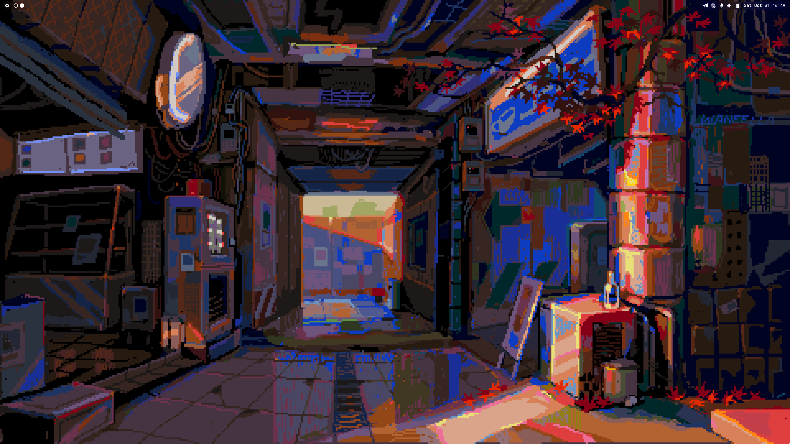
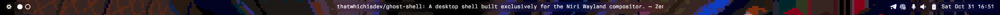
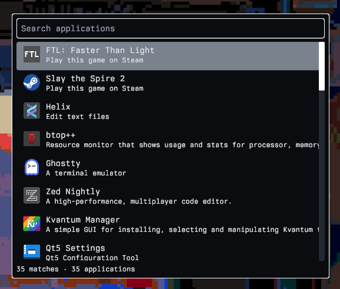
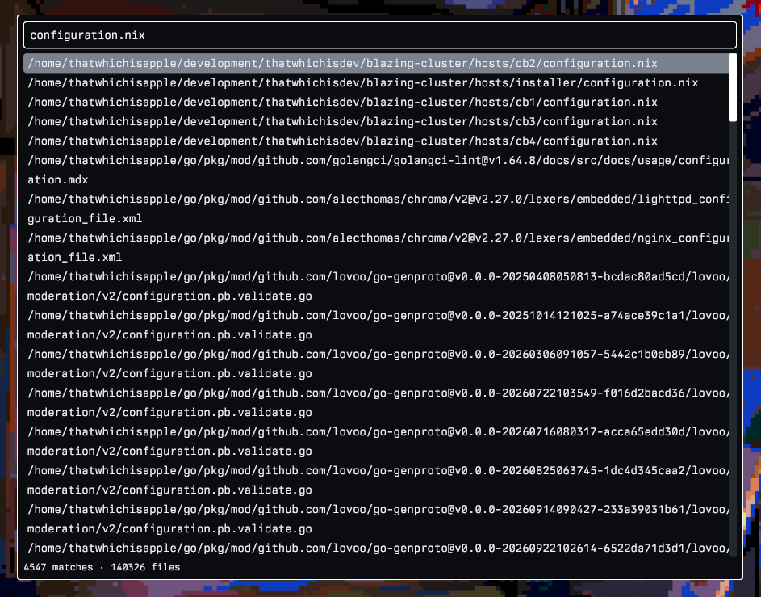
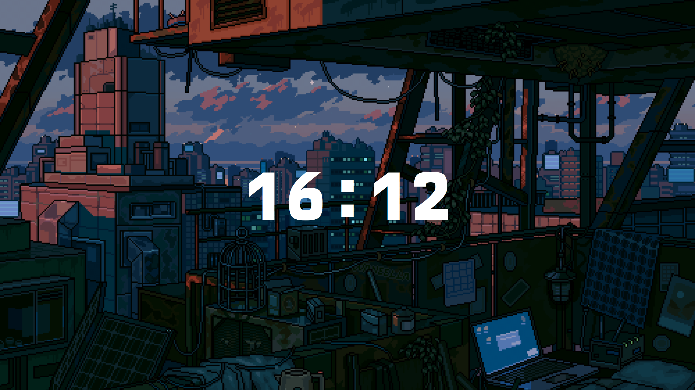

> [!IMPORTANT]
> Remove this line to confirm you've reviewed this PR before submitting.
# Ghost Shell

A desktop shell for the Niri Wayland compositor, built with iced.

## Preview

## Overview

Ghost Shell is a desktop shell built exclusively for the Niri Wayland
compositor. It uses iced with Waycrate's Wayland shell integration.

The philosophy behind the project is dead simple: be efficient, provide the
necessary tooling, stay simple where possible, and delegate whatever makes sense
to the compositor.

The project's name is inspired by the anime Ghost in the Shell.

### Bar

The bar follows a widely adopted layout with three sections: start, center, and
end. Its current widget layout is fixed; appearance and outputs are
configurable. See the [bar guide](docs/wiki/Bar.md) and [widget
reference](docs/wiki/Widgets.md).

### Launcher

The application launcher is intentionally simple. It displays all applications
discovered on the system and allows you to launch them through Niri's `spawn`
command. Terminal applications are launched inside a terminal emulator.

### Finder

The file and directory finder is one of the ideas I'm particularly proud of. It
takes advantage of the `fff` library to build an indexed tree of files and
directories, allowing Ghost Shell to quickly find files across the system.

### Lockscreen

The lockscreen supports animated wallpapers. What else do you need?

### Greeter

The boot greeter displays a wallpaper, clock and authentication prompts through
greetd. It starts independently of the desktop lockscreen. See the [greeter
guide](docs/wiki/Greeter.md) for NixOS setup and validation requirements.

## Roadmap

The project is still in a very early alpha stage. I don't expect a release any
time soon. There is still a lot to implement, test, and improve before I can be
confident that Ghost Shell is robust and performant enough for a proper release.

- [ ] Bar
  - [ ] Widget: System Menu
  - [x] Widget: Niri Workspaces
  - [x] Widget: Focused Window
  - [x] Widget: Tray
  - [ ] Widget: Notifications
  - [ ] Widget: Camera
  - [ ] Widget: Audio Control (Speakers/Microphone)
  - [ ] Widget: Bluetooth Control
  - [ ] Widget: Network Control (Wi-Fi/Ethernet)
  - [ ] Widget: Power Control (Battery/Power modes)
  - [x] Widget: Clock
  - [ ] Widget: Screenshot & Screen recording
  - [ ] Widget: Theme Polarity Changer
  - [ ] Widget: Weather
- [x] Launcher
- [x] Finder
- [x] Lock Screen
- [x] Greeter (greetd; live login validation pending)
- [ ] Clipboard
- [ ] Wallpapers
- [ ] Theming

## Documentation

Start with the [wiki](docs/wiki/README.md) for the project overview and user
guides:

- [Installation](docs/wiki/Installation.md) and [getting
  started](docs/wiki/Getting-Started.md)
- [Configuration](docs/wiki/Configuration.md) and
  [theming](docs/wiki/Theming.md)
- [Bar](docs/wiki/Bar.md) and [individual widgets](docs/wiki/Widgets.md)
- [Launcher](docs/wiki/Launcher.md), [finder](docs/wiki/Finder.md), and
  [lockscreen](docs/wiki/Lockscreen.md), and [boot
  greeter](docs/wiki/Greeter.md)
- [Wallpapers](docs/wiki/Wallpapers.md) and [CLI
  commands](docs/wiki/Commands.md)
- [Architecture](docs/wiki/Architecture.md) and
  [troubleshooting](docs/wiki/Troubleshooting.md)

Build, run, and contribution instructions live in
[CONTRIBUTING.md](docs/CONTRIBUTING.md). The roadmap above tracks completion;
implemented features may still have alpha limitations documented in their
respective guides.

## Acknowledgments

Ghost Shell would not be possible without the excellent work of the projects it
builds upon:

- [niri](https://github.com/niri-wm/niri) - the backbone of the project and my
  favorite Wayland compositor. It provides a lot of functionality Ghost Shell
  can rely on, such as spawning applications, streaming compositor state, and
  much more.
- [iced](https://github.com/iced-rs/iced) - the Rust GUI framework.
- [Waycrate](https://github.com/waycrate/exwlshelleventloop) - Wayland layer,
  popup, output, blur, and session-lock integration for iced.
- [awww](https://codeberg.org/LGFae/awww) - an excellent animated wallpaper
  daemon that introduced me to one of my favorite animated wallpapers. It has
  also been a great project to learn from while building Ghost Shell's own
  animated wallpaper renderer.
- [fff](https://github.com/dmtrKovalenko/fff) - amazing file search toolkit,
  powers finder and launcher's applications filtering.

## Licensing

Ghost Shell is licensed under the [MIT License](LICENSE.md).
