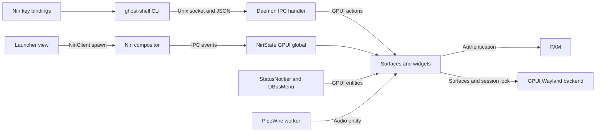
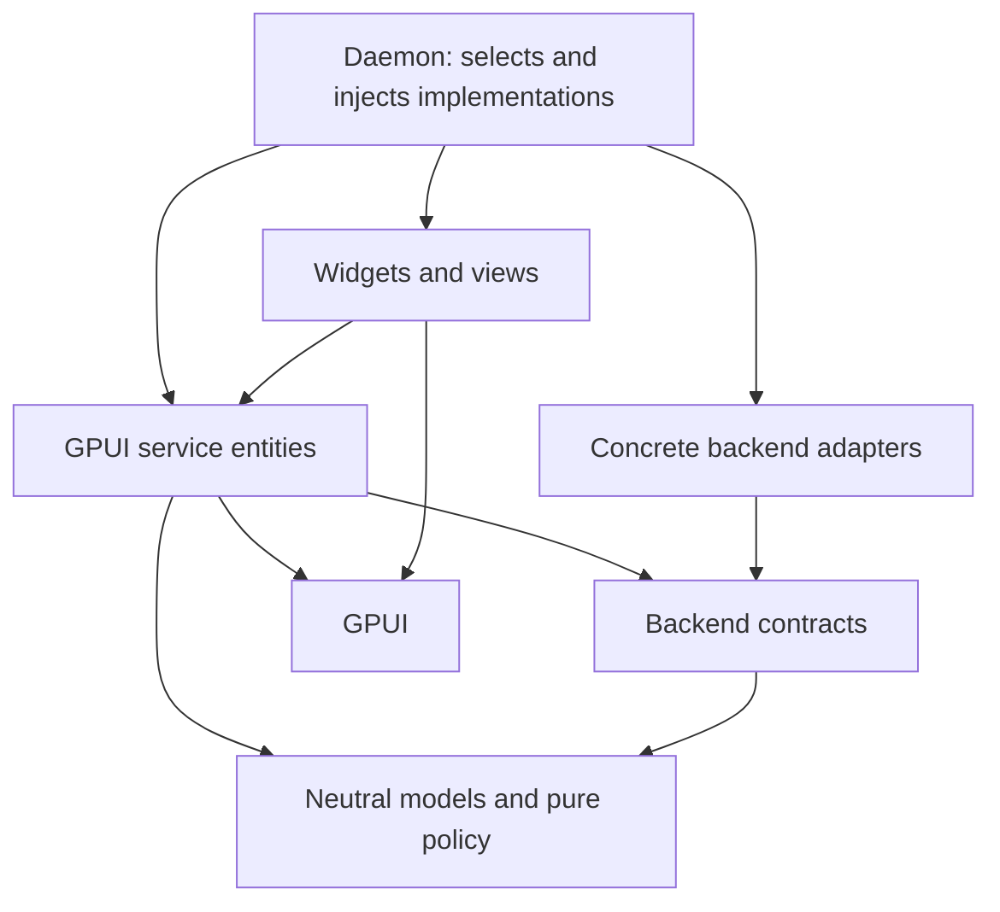

# Architecture

[Wiki](README.md) · [Contributing](../CONTRIBUTING.md)

## Accepted direction

**Keep GPUI as the application host. Make widget backends replaceable through
stable service APIs and backend contracts.** This is the architectural decision;
the extraction described below is not yet implemented. Proposed crate and port
names are responsibilities to establish during migration, not existing APIs.

The goal is to replace Niri, PipeWire, or another service implementation without
rewriting widgets that use the same supported capabilities. GPUI continues to
provide entities, globals, actions, subscriptions, tasks, and window lifecycle.
Application coordination and canonical service state may live in GPUI entities.
We do not introduce a second application runtime, event bus, or duplicate state
store, and a GPUI-independent application layer is not a requirement.

There are two API boundaries:

- **Widget-facing service API:** a capability-oriented GPUI entity or handle,
  such as audio state observation and volume control. It can expose GPUI
  entities, subscriptions, and tasks. It must not expose backend protocol types
  or select a concrete backend.
- **Backend contract:** commands, results, snapshots, events, errors, and
  capability declarations using ordinary Rust types. It must not require GPUI
  or expose Niri, PipeWire, D-Bus, or PAM implementation types. Concrete adapters
  implement this contract and are injected at startup.

A backend change that satisfies the contract changes adapter selection and
packaging, not the widget API. Backend-specific behavior belongs in the adapter;
validation and shell policy belong in the service entity or pure helpers.
Optional capabilities and unavailable services must have explicit behavior.
Different backend semantics can still require a deliberate contract extension.

The GUI and CLI are driving entry points. Service dependencies are driven
adapters, even when a subscription delivers events back into the application.
D-Bus includes both incoming registration and outgoing item/menu interactions.
These roles follow the boundary distinction in
[ports and adapters](https://alistair.cockburn.us/hexagonal-architecture), applied
here to external services rather than to making the entire shell framework-free.

Niri remains the supported compositor during migration. Replacing its IPC
adapter does not automatically make GPUI's layer-shell, popup, blur, or
session-lock behavior compatible with another compositor. Those platform
capabilities still require integration testing. Replacing GPUI would require
rewriting views and some application coordination; it is not this refactor's goal.

## Current processes and state

The [daemon](../../crates/ghost-shell-daemon/src/main.rs) owns the GPUI
application. It initializes Tokio and components, configuration and theme,
D-Bus/Niri/IPC, output state, then wallpaper, lockscreen, launcher, finder, and
bar. The CLI is a separate short-lived process. Audio starts from the audio
widget rather than directly from the daemon.

GPUI entities and globals currently hold both service state and presentation
state. Tokio bridges asynchronous work to GPUI; PipeWire runs a dedicated
thread. Constructors and `init(cx)` functions frequently discover and start
their own dependencies. The daemon therefore controls initialization order
without fully controlling dependency construction or service lifetime.

The bar and wallpaper reconcile display changes. Bars share most widget
entities and create workspace widgets per output. Launcher and finder prefer
the focused output, then the primary output. Configuration loads at startup;
display reconciliation is not configuration hot reload. Widgets are compiled
Rust crates, not runtime plugins.

## Current integration inventory

“Target port” names below describe a contract to design during migration. An
integration can implement several ports; a port can have several adapters.

| Integration and current owner | Current boundary and coupling | Target port or placement |
| --- | --- | --- |
| **Niri IPC** — `ghost-shell-niri` | Socket client, JSON protocol, event reduction, GPUI globals, and startup are combined. `NiriState` reaches output selection, focus, and workspace views. | Driven `CompositorStateSource` with shell-owned output, window, and workspace snapshots/events. Keep Niri requests and identifiers private to the adapter. Add control operations only as features require them. |
| **Application execution** — launcher view and Niri client | The view constructs `NiriClient` and sends spawn commands. Terminal wrapping uses hard-coded `ghostty -e` in the view. | Driven `ApplicationLauncher`; application policy creates a backend-neutral launch request. Niri is the first implementation. Another launcher must preserve agreed session/environment semantics, not merely start a process. |
| **Wayland and GPUI platform** — vendored `ghost-shell-gpui`, surfaces, `ghost-shell-app` | Displays, layer-shell bars/backgrounds, popups, input, and session-lock surfaces use GPUI handles. Output policy stores `Rc<dyn PlatformDisplay>` and combines GPUI identity with Niri state. | Keep graphics/input infrastructure in GPUI. Keep display discovery, surface handles, and session-lock lifecycle in GPUI-hosted coordination. Translate neutral compositor state into GPUI output selection centrally; a replacement platform abstraction is not required. |
| **PipeWire** — `ghost-shell-audio` | A private backend handles the native graph and commands; `AudioState` already uses owned Rust data. The public facade still requires GPUI and constructs a concrete backend. | Driven `AudioBackend` using neutral models, implemented by a PipeWire adapter. Retain the GPUI audio entity, its widget-facing API, and observation; inject the backend instead of constructing it. |
| **StatusNotifier registration** — `ghost-shell-dbus` | A D-Bus watcher publishes registration events into GPUI. The tray view parses registrations and orchestrates item discovery. | Driving `TrayRegistration` contract for external item registration/removal. Move discovery coordination into the GPUI tray service entity. |
| **StatusNotifier items and DBusMenu** — D-Bus crate and tray widget | Clients expose service/object-path identities and menu protocol models through GPUI entities/tasks. The view manages discovery, menus, and invalidation. | Driven `TrayItemSource` and `TrayMenuBackend`; neutral item/menu identities and snapshots. D-Bus owns service names, object paths, proxy lifetimes, and wire conversions. Preserve menu invalidation and subscription lifetimes. |
| **Desktop entries and icon themes** — launcher and tray | Launcher enumerates desktop entries, parses `Exec`, reads locale/theme settings, and resolves icon paths. Tray resolves theme icons and decodes protocol pixmaps in its view support code. | Driven `ApplicationCatalog` and a presentation resource resolver. Keep freedesktop discovery/decoding outside application policy; create renderer images only in the presentation layer. |
| **File search and watching** — finder `Search` | The fff wrapper already returns Ghost-owned results, but exposes fff `ScanProgress`. The view constructs the index, polls progress, and controls result generations. | Driven `FileSearch` returning owned results and indexing status. The fff adapter owns indexing/watching and library-specific query translation; the application owns cancellation and stale-result policy. |
| **PAM and current user lookup** — lockscreen `auth` | PAM is isolated in a module, but its result type and environment-based username lookup are called from presentation. Authentication and unlock coordination occur in the view. | Driven `Authenticator` and a session identity provider. Translate PAM results at the boundary. Keep authentication policy and session-lock state separate from password input/rendering. |
| **Battery information** — power widget | The widget owns `starship_battery::Battery` directly; it reads an initial battery and has no refresh implementation. Failure currently aborts all bar initialization. | Driven `PowerStatusSource` returning neutral battery/power state. No battery and service failure must be distinct states; unrelated widgets must remain usable. |
| **Configuration and XDG directories** — `ghost-shell-config` | Schema/defaults, TOML loading, directory discovery, `ConfigError`, and GPUI `Global` are combined. Startup logs load failure and uses defaults. | Neutral config model/defaults plus a driven file/TOML loader. Bootstrap supplies configuration and resolved paths. Preserve the existing fallback until a separate behavior change is agreed. |
| **Wallpaper files and cache** — `ghost-shell-wallpaper` | File reads, image/GIF decoding, postcard cache I/O, animation representation, GPUI images, and surface lifetime share one feature crate. | Driven wallpaper resource/cache access, with file format and cache serialization in adapters. Keep animation algorithms local and rendering objects in presentation. A trait per codec or compression library is unnecessary. |
| **Clock and timers** — clock widget and lockscreen | Both call `jiff::Zoned::now()` and schedule GPUI timers. | Pass time into pure formatting/policy functions; introduce a `Clock` port when application timing needs deterministic tests. UI repaint scheduling remains presentation infrastructure. |
| **Shell control IPC** — CLI, `ghost-shell-ipc`, actions | JSON protocol, Unix socket client/server, GPUI action dispatch, and initialization share a crate. The CLI consequently depends transitively on GPUI. `Handled` follows dispatch, not confirmation of the requested state. | Driving IPC entry point. Separate wire DTOs/client transport from GPUI dispatch; route requests to existing service/action APIs and explicitly define accepted versus completed responses. |
| **Desktop portals, clipboard, graphics, fonts, accessibility, notifications sent by GPUI** — vendored framework | Platform facilities already sit behind GPUI infrastructure. Their presence does not mean Ghost implements a user-facing feature for each one. | Retain framework boundaries. Introduce a shell port only when a shell use case consumes one of these services; do not wrap the renderer, font stack, or every framework dependency. |
| **Network and notification center** — widget crates and D-Bus notification modules | Network and notification widget sources and notification service modules are empty. No network backend or notification server is implemented there. | Future network service dependencies would be driven; incoming desktop notification requests would drive notification use cases. Define those contracts with the features, not speculative backends now. |

Bluetooth, weather, clipboard history, screenshot/recording UI, and power-mode
control are roadmap items, not implemented integrations established by this
inventory. Niri protocol variants for screenshots/casts are not equivalent to
complete shell features. Finder open/preview handlers are also placeholders;
they do not currently execute `xdg-open`.

Source entry points for this assessment:

- [Niri initialization](../../crates/ghost-shell-niri/src/lib.rs),
  [protocol/state](../../crates/ghost-shell-niri/src/protocol.rs), and
  [output integration](../../crates/ghost-shell-app/src/lib.rs).
- [Launcher execution](../../crates/ghost-shell-launcher/src/view.rs),
  [desktop entries](../../crates/ghost-shell-launcher/src/entries.rs), and
  [finder search](../../crates/ghost-shell-finder/src/search.rs).
- [Audio facade](../../crates/ghost-shell-audio/src/audio.rs),
  [state](../../crates/ghost-shell-audio/src/state.rs), and
  [PipeWire backend](../../crates/ghost-shell-audio/src/backend.rs).
- [D-Bus facade](../../crates/ghost-shell-dbus/src/dbus.rs),
  [item API](../../crates/ghost-shell-dbus/src/item.rs),
  [menu API](../../crates/ghost-shell-dbus/src/menu.rs), and
  [tray orchestration](../../crates/ghost-shell-widgets/ghost-shell-widget-tray/src/tray.rs).
- [PAM](../../crates/ghost-shell-lockscreen/src/auth.rs),
  [lock lifecycle](../../crates/ghost-shell-lockscreen/src/lockscreen.rs),
  [battery widget](../../crates/ghost-shell-widgets/ghost-shell-widget-power/src/power.rs),
  and [bar initialization](../../crates/ghost-shell-bar/src/lib.rs).
- [Configuration](../../crates/ghost-shell-config/src/config.rs),
  [wallpaper](../../crates/ghost-shell-wallpaper/src/wallpaper.rs),
  [IPC dispatch](../../crates/ghost-shell-ipc/src/lib.rs), and
  [GPUI Wayland integration](../../crates/ghost-shell-gpui/src/linux/wayland/client.rs).

## Target dependency boundaries

These arrows mean **compile-time dependency**, not runtime message flow.

At runtime, a widget calls a service entity; that entity calls an injected
backend handle. The adapter translates the request, performs I/O, and returns
neutral results or events. The entity applies updates to its canonical state
and notifies GPUI observers. Rendering reads that state; it does not maintain a
second independent service model.

For audio, preserve the useful existing `Audio` entity and `AudioState` split.
Extract the concrete PipeWire backend, inject its replacement behind an audio
contract, and keep GPUI observation and validation in the entity. Another audio
backend should require no changes to the widget or the entity's public API.

### Ownership and packaging

Use crates to isolate dependency sets and modules to organize capabilities.
There is no requirement for a crate per port, command, query, or use case.
The following responsibilities guide extraction; they do not authorize a mass
move of the current source tree.

| Crate or group | Target responsibility |
| --- | --- |
| `ghost-shell-domain` (proposed) | Ordinary Rust models and pure helpers, organized into capability modules. No GPUI or concrete backend dependencies. Extract existing useful models rather than creating a domain framework. |
| `ghost-shell-ports` (proposed) | Backend contracts organized into compositor, launching, audio, tray, search, authentication, and other justified capability modules. Depends on neutral models, not implementations. Do not manufacture an inbound trait for every GPUI action. |
| GPUI service modules, initially in existing capability crates | Own stable widget-facing APIs, canonical state, validation, command handling, and backend event subscriptions. Can depend on GPUI and ports, but not concrete backend crates. `ghost-shell-audio` can retain its GPUI facade after PipeWire extraction. Consolidation into a service crate is optional, not a prerequisite. |
| `ghost-shell-app` | GPUI-hosted output selection and application coordination. Replace direct Niri state access with the compositor service API; GPUI display handles can remain here. |
| `ghost-shell-niri`, extracted PipeWire/PAM/fff adapters, `ghost-shell-dbus` | Technology-specific workers, protocol state, discovery, commands, and event translation. One technology crate can implement several ports using modules. No GPUI or widget dependency in service backend adapters. |
| Widgets, bar, launcher, finder, lockscreen, wallpaper | Driving UI adapters with GPUI interaction and rendering. Use injected service entities; keep local selection, focus, scroll, and render state. Do not create service backend connections. |
| GPUI, components, theme, assets, actions, Tokio bridge | Retain framework responsibilities. No replacement graphics, entity, subscription, or action framework. Display/surface/session-lock APIs can remain direct GPUI integration. |
| Configuration, resource and filesystem modules | Keep current GPUI registration where useful. Separate I/O from shared models as needed for a concrete replacement or test seam; no mandatory trait per file or codec. |
| IPC and CLI | Separate protocol/client dependencies from GPUI dispatch so the CLI does not pull in the UI framework. Daemon-side dispatch invokes the same service/action behavior as the UI. |
| `ghost-shell-daemon` | Construct and inject adapters into services, register service entities, connect entry points, and own startup/shutdown. Widgets do not select implementations. |

Inbound/outbound terminology remains useful for conversations and adapter
modules. A separate top-level presentation layer is not necessary. Physical
folder consolidation can follow this decision without changing these dependency
rules.

### Boundary rules

1. Widgets must not import concrete service backends or their protocol types.
   For example, no `NiriClient`, Niri `Workspace`, PipeWire node, D-Bus proxy,
   or PAM result in widget/service APIs.
2. GPUI service entities accept backend implementations through their
   constructors. A global may hold the resulting entity for shared access;
   retrieving it must not silently choose or construct a backend.
3. Backend contracts and neutral models must compile without GPUI or native
   backend libraries. Service entities deliberately depend on GPUI. Do not
   apply the framework-free requirement to the whole application.
4. Backend adapters translate their own protocol objects, errors, and IDs into
   contract types. They must not update GPUI entities or dispatch UI actions.
   A GPUI-side task receives their events and updates the service entity.
5. Prefer narrow capability contracts to a universal `Backend` or `Services`
   interface. Multiple methods and multiple ports may share a crate.
6. Keep the canonical application state in the service entity. Adapter caches
   needed for protocol operation are allowed; a second application state store
   and generic event bus are not required.
7. Backend substitution must preserve both the service API and its semantics.
   Contract changes are explicit design changes, not hidden backend quirks that
   every widget must accommodate.

## Contract semantics

Stable signatures alone do not make backends interchangeable. Each contract
must document the behavior its consumers rely on:

- **Identity and capabilities:** shell-owned IDs, their lifetime across removal
  and reconnect, and explicit unsupported operations. Keep raw backend IDs
  private. Reconcile compositor output IDs with GPUI displays in one place.
- **Initial state and events:** snapshot/subscription ordering, event ordering,
  disconnect/stale state, reconnection, and resynchronization. The service
  entity owns the canonical application state and notifies widgets of changes.
- **Commands and outcomes:** distinguish queuing, backend acceptance, and an
  observed effect. Preserve audio's existing distinction; define IPC replies
  accordingly. Avoid blind retries of non-idempotent commands.
- **Errors and availability:** distinguish invalid input, missing resources,
  unsupported capabilities, unavailable services, and denied operations as
  appropriate. A missing battery or failed audio backend must not prevent
  unrelated widgets from running.
- **Lifetime and concurrency:** define ownership of workers, subscriptions,
  cancellation, and shutdown. Keep blocking authentication and I/O off the UI
  thread and PipeWire objects on their worker. Use bounded or explicitly
  coalesced updates with resynchronization where necessary; preserve command
  outcomes.
- **API shape:** widget-facing handles can use GPUI types. Backend contracts
  cannot. Use ordinary futures or narrow command/event handles; document any
  deliberate runtime dependency. No universal executor abstraction is needed.

PAM authentication and compositor session locking remain distinct operations.
Authentication success does not confirm a lock/unlock protocol transition.
The GPUI-hosted lock coordinator must preserve confirmed/failed transitions,
keep the session locked after failed authentication, and report unavailable
lock support. A normal fullscreen window is not a session-lock substitute.

## Migration and acceptance

1. **Pilot audio.** Keep its GPUI entity and public widget API; move PipeWire
   into a concrete adapter, extract neutral contracts/models, and inject the
   backend at startup. Use a fake to test updates, missing endpoints,
   disconnects, and command failures.
2. **Isolate Niri.** Introduce a compositor service entity with neutral state.
   Remove Niri models from focus/workspace widgets and inject launch execution
   into the launcher service. Keep GPUI output reconciliation and current
   launch behavior while changing the backend boundary.
3. **Isolate tray, search, and power backends.** Move discovery coordination and
   service lifetime out of views. Preserve menu invalidation and stale-search
   protection. Explicitly test improvements to optional-service failure handling.
4. **Isolate authentication.** Inject a PAM implementation behind an
   authentication contract while retaining GPUI's lock lifecycle. Validate
   denied authentication and actual compositor lock transitions.
5. **Apply the pattern to further services as needed.** Introduce resource,
   configuration, clock, network, or notification contracts when a real use
   case or testing need defines them; retain empty roadmap features as such.

Each migrated capability is complete when a fake and the real backend satisfy
its contract, widgets use the same service API with either, and only startup
composition selects the concrete implementation. This is startup/build-time
substitution, not a promise of live backend hot-swapping or a plugin ABI.

Test pure policy and contract types without GPUI. Test service entities using
GPUI test support and fake backends; these tests need not contact Niri,
PipeWire, D-Bus, or PAM. Keep real backend integration tests for protocol
translation, rendering, and session-lock behavior. Fakes do not validate those
external systems.

Add Cargo dependency checks to CI for widgets/services depending on concrete
backends, adapters depending on GPUI, and neutral contracts depending on native
libraries. Check transitive/enabled-feature dependencies as well. GPUI itself
retains its native platform dependencies; the restriction is on extracted
service adapters, not on the framework. The current CI does not enforce these
proposed boundaries yet.

This migration changes service boundaries, not the supported UI framework.
Record temporary backend leaks during extraction and remove them capability by
capability. No additional application-state or communication framework is
needed to adopt this design.
