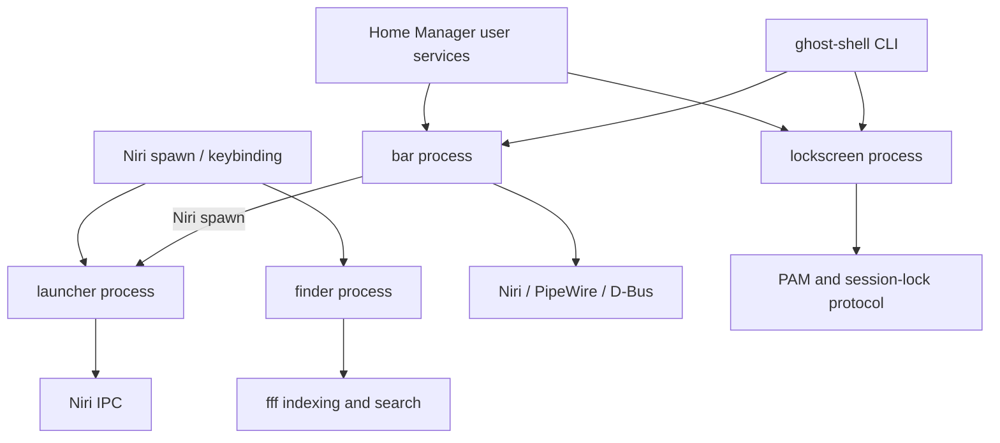

# Architecture

[Wiki](README.md) · [Application lifecycle](../APPLICATION-RESTRUCTURE.md)

Ghost Shell has two resident desktop daemons (bar and lockscreen) and two
on-demand applications (launcher and finder), each with its own Waycrate/iced
runtime. Home Manager manages only the daemons; the CLI addresses their IPC
endpoints. Niri launches launcher/finder directly, including the bar's menu action.
Each GUI process owns its runtime, messages, subscriptions and Wayland connection.
Shared crates contain reusable implementations, not a shared GUI runtime.
An additional boot greeter runs separately under greetd, outside the user session;
see the [greeter guide](Greeter.md).

## Workspace and ownership

| Location | Responsibility |
| --- | --- |
| `crates/ghost-shell-core/ghost-shell-cli/` | User-facing commands sent directly to applications |
| `crates/ghost-shell-applications/ghost-shell-bar/` | Bar and wallpaper surfaces, audio/tray popups and their services |
| `crates/ghost-shell-applications/ghost-shell-launcher/` | Desktop discovery, selection, launcher overlay and Niri spawn requests |
| `crates/ghost-shell-applications/ghost-shell-finder/` | Indexing, searching, selection and finder overlay |
| `crates/ghost-shell-applications/ghost-shell-lockscreen/` | Session-lock surfaces, PAM authentication, unlock and lock wallpaper |
| `crates/ghost-shell-applications/ghost-shell-greeter/` | Boot login surfaces and greetd conversation/session handoff |
| `crates/ghost-shell-core/` | CLI, configuration types, assets and theme |
| `crates/ghost-shell-components/` | Reusable wallpaper decoder/cache and shader playback |
| `crates/ghost-shell-adapters/` | Audio, D-Bus, IPC, Niri and system integrations |
| `crates/ghost-shell-widgets/` | Individual bar features and their associated popups |

Every application has `src/main.rs` for process startup and `src/app.rs` for its
runtime and lifecycle. Existing library modules own feature state, update and view
logic. Application crates do not depend on each other. `ghost-shell-app` has been
removed. All packages remain members of one Cargo workspace, with dependency
versions/paths at the root and features selected in consuming crates.

## Process lifecycle

There is no supervisor or global startup barrier. Only bar and lockscreen bind
IPC sockets. Launcher and finder hold per-application file locks in
`XDG_RUNTIME_DIR` to prevent duplicate processes, without accepting IPC. A second
invocation exits without toggling the existing window. Locks release on process
exit, including crashes; the lock files remain and must not be unlinked while an
instance is running. Each application starts and stops independently.

Only bar and lockscreen stay resident. Launcher and finder exit on Escape or
surface closure; launcher also exits after successful application launch. Bar owns wallpapers and
configured bars. Desktop applications independently read shared `config.toml` at
startup, deserializing only their relevant sections plus shared general/theme
settings. The bar and lockscreen also share wallpaper settings. They fall back
to their old named file only when the shared file is absent. Configuration is
not live-reloaded. The boot greeter retains separate system-owned configuration.
Sharing a configuration file does not introduce shared runtime state.

Home Manager creates two graphical-session services. The bar restarts on failure. The lockscreen does not automatically restart after a crash. It handles
SIGTERM/SIGINT and IPC shutdown, deferring exit while a lock is pending, active or
unlocking. Its unit has no force-kill timeout. Stop/restart during a lock therefore
waits for authentication. Direct SIGKILL cannot run this lifecycle logic.

## IPC

All sockets live in `XDG_RUNTIME_DIR`:

| Socket | Commands |
| --- | --- |
| `ghost-shell-bar` | Bar open/close/toggle; readiness and shutdown |
| `ghost-shell-lockscreen` | Lock; readiness and deferred shutdown |

The JSON envelope remains; launcher/finder requests and endpoints have been removed. Wrong-endpoint
commands return errors. The CLI and bar read the owning application's reply directly. Internal calls have a ten-second timeout; a timeout does not establish
that an operation was not performed. `Handled` for ordinary UI commands acknowledges
acceptance, not presentation of a rendered frame. Lock requests are held until the
compositor emits `Locked`; denial returns an error. Shutdown replies are flushed
before an idle process exits. Active lockscreen shutdown acknowledges the request
and defers exit until unlock.

The IPC adapter contains Unix transport, endpoint addressing and request calls. Its
optional `iced` feature supplies the subscription bridge and shutdown task; the
CLI does not require that feature in its manifest. Each
daemon's subscription owns its server. A bind/listener error exits an idle
application; a locked lockscreen remains alive until it can unlock safely.

## Application state and services

The bar owns canonical audio state and its own Niri state. Launcher and finder ask Niri to select the active output through the Wayland
layer-shell protocol, avoiding startup waits for an IPC output snapshot. Widgets consume
bar-owned state and emit typed messages; they do not open duplicate service clients.
The tray watcher and audio worker exist only in the bar process. Audio discovery and
updates are event-driven, with command failures returned to the owning feature.

Launcher emits `Launch(Vec<String>)` containing the prepared command. Its application
builds a Niri `Request::Action(Action::Spawn { command })`, sends the task and closes
only on success. Finder indexing/search, launcher discovery, wallpaper decoding and
PAM run outside the UI event loop. Finder generation checks reject stale results. Finder indexes the current user's
home directory, with filesystem-root scanning disabled. Index initialization runs
on a blocking worker while the UI accepts input. Enter during indexing queues a
search until the scan completes. The index is rebuilt on each invocation; there
is no persistent index yet.

The lockscreen owns all authentication and session-lock state. Only a successful,
current authentication attempt while locked requests unlock. Password-bearing
messages redact Debug output. Lock surface registration uses Waycrate's synchronous
new-shell callback, including newly connected outputs. The bar and CLI have
no unlock command and never receive credentials.

## Niri adapter

`NiriStream::try_new()` negotiates EventStream with five-second connection and
acknowledgement timeouts. `connect()` returns `Straw<Never, NiriEvent, StreamError>`.
Malformed event JSON logs a possible protocol-version mismatch and is skipped on
the same connection. EOF/read failures terminate the Straw. The adapter's `events()`
stream forwards progress and terminal errors, then reconnects after two seconds.
Applications subscribe with `Subscription::run` and clear stale state on failure.
Dropping that subscription cancels reading and retry waits; no worker is detached.

`send(Request)` returns `Task<Result<(), NiriClientError>>`. The process-local
`NiriClientPool` is a managed Deadpool pool limited to one command connection.
It connects lazily and serializes complete exchanges. Interrupted or failed exchanges
mark the client non-reusable; the next checkout replaces it. A valid compositor
rejection preserves the connection. There is no background health polling or action
replay. An idle disconnect is detected by a command; the following call reconnects.
`EventStream` is rejected by this command API. All client logic and SNAFU errors
live in `unix/client.rs`; the crate root declares modules and exports APIs.

## Rendering and performance

All GUI applications use pinned Waycrate layer/session-lock integration. Launcher
and finder retain centered overlays, blur and exclusive keyboard interaction.
Bar audio and tray menus remain popups attached to their bar surface.

Wallpaper playback uses compressed frame changes and a persistent GPU texture per
playback surface. Its shader schedules frame deadlines and uploads only changed
frames, without application-wide frame messages. Playback resources are shared
within a process; bar and lockscreen do not share GPU or decoded memory across
processes. Each running application has its own renderer and associated memory costs.

Launcher and finder render visible rows. Backend updates drive views. Bar clock
updates follow its configured precision; lockscreen clock ticks only while a lock
is active. Finder progress polling runs only during indexing. Interactive and
performance acceptance remain tracked in the restructuring plan.

Sources: [CLI](../../crates/ghost-shell-core/ghost-shell-cli/src/main.rs),
[bar runtime](../../crates/ghost-shell-applications/ghost-shell-bar/src/app.rs),
[launcher runtime](../../crates/ghost-shell-applications/ghost-shell-launcher/src/app.rs),
[finder runtime](../../crates/ghost-shell-applications/ghost-shell-finder/src/app.rs),
[lockscreen runtime](../../crates/ghost-shell-applications/ghost-shell-lockscreen/src/app.rs).
